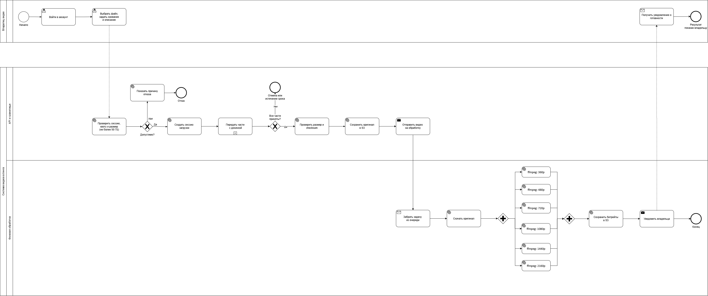
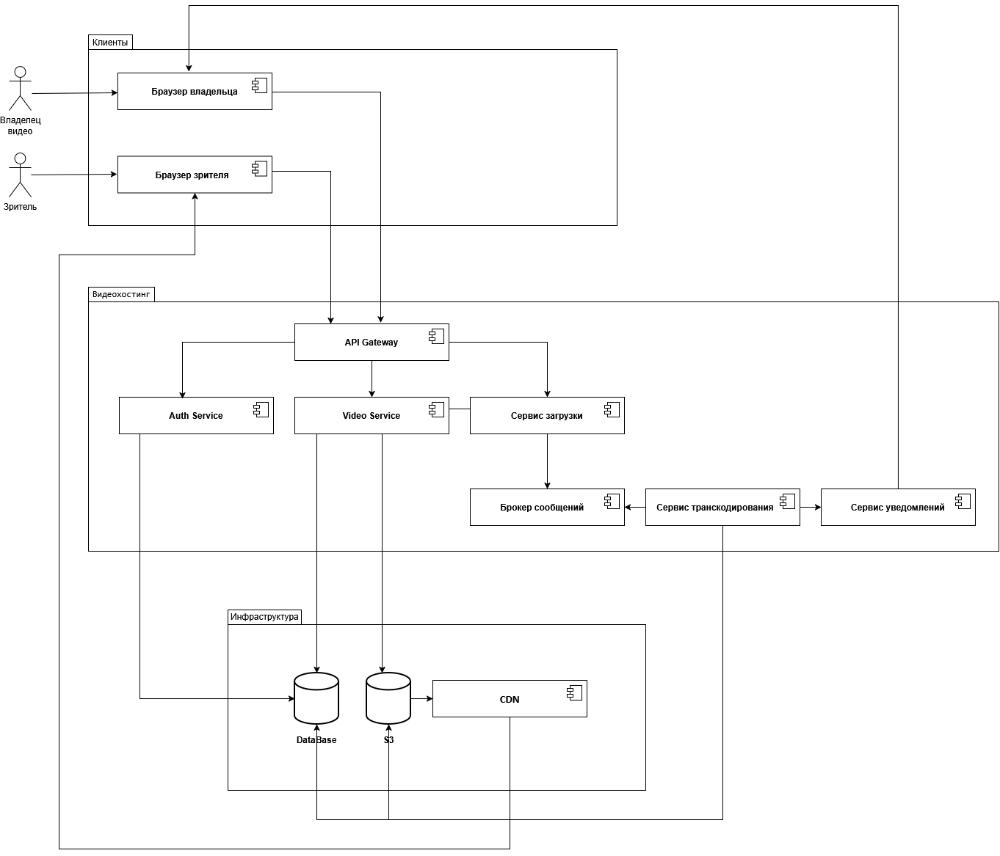
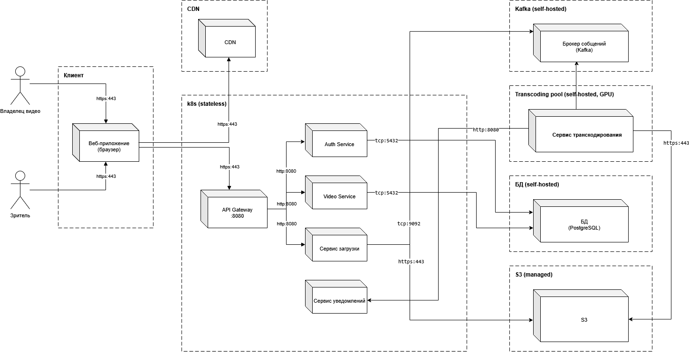
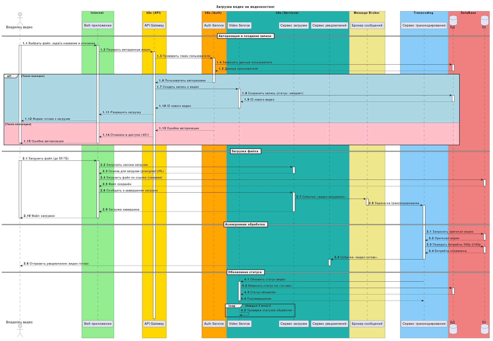

#  Архитектура видеохостинга (VideoHost)

> **Проект по проектированию архитектуры видеохостинга** в рамках курса **Fullstack Analyst**

---

  
  
  
  

---

## 📑 Оглавление

- [📋 Описание задачи](#-описание-задачи)
- [ Акторы системы](#-акторы-системы)
- [📝 User Stories](#-user-stories)
- [🏗️ Архитектурные решения](#️-архитектурные-решения)
- [📊 Диаграммы](#-диаграммы)
- [🛠️ Технологический стек](#️-технологический-стек)
- [📈 Ключевые требования](#-ключевые-требования)
- [🚀 Дальнейшее развитие](#-дальнейшее-развитие)

---

## 📋 Описание задачи

Разработать масштабируемую архитектуру видеохостинга с поддержкой:

| Возможность | Описание |
|:-----------:|:---------|
| 📤 **Загрузка** | Поддержка видеофайлов до **50 ГБ** с дозагрузкой при обрыве |
| 🎞️ **Транскодирование** | Автоматическая генерация битрейтов **360p → 2160p** через FFmpeg |
| 🌐 **Стриминг** | Доставка контента через **CDN** с географическим распределением |
| ⚡ **Асинхронность** | Обработка через **очереди сообщений** (Kafka) |
| 💾 **Хранение** | Отказоустойчивое хранилище с репликацией оригиналов |
| ▶️ **Видеоплеер** | Управление воспроизведением, встраивание по ссылке |

---

## 👥 Акторы системы

### 🎥 Владелец видео

| Действие | Описание |
|:--------:|:---------|
| 📤 Загрузка | Загружает видео в систему (с возможностью дозагрузки) |
| ✏️ Управление | Редактирование названия, описания, удаление роликов |
|  Статистика | Просмотр просмотров и лайков |
| 🔐 Авторизация | Управление только своими видео |

### 🍿 Зритель

| Действие | Описание |
|:--------:|:---------|
| ▶️ Просмотр | Смотрит видео **без регистрации** в обычном и ускоренном режимах |
| ❤️ Взаимодействие | Лайки и комментарии *(требуется регистрация)* |
| 🔗 Шеринг | Делится видео в социальных сетях, встраивает по ссылке |
| 🔍 Поиск | Ищет видео по названию и описанию |

---

## 📝 User Stories

### 🎥 Владелец видео

| # | User Story |
|:--|:-----------|
| 1 | Как владелец видео, я хочу **зарегистрировать аккаунт**, чтобы загружать ролики и управлять ими |
| 2 | Как владелец видео, я хочу **войти в личный кабинет**, чтобы увидеть свои видео и доступные действия |
| 3 | Как владелец видео, я хочу **выйти из аккаунта**, чтобы никто другой не получил доступ к моим видео |
| 4 | Как владелец видео, я хочу **выбрать видео и заполнить название и описание**, чтобы опубликовать его для зрителей |
| 5 | Как владелец видео, я хочу **удалить своё видео**, чтобы убрать его из доступа |
| 6 | Как владелец видео, я хочу **изменять название и описание** своего ролика, чтобы исправить или дополнить информацию |
| 7 | Как владелец видео, я хочу **видеть просмотры и лайки** каждого своего видео, чтобы оценивать интерес аудитории |

### 🍿 Зритель

| # | User Story |
|:--|:-----------|
| 1 | Как зритель, я хочу **искать видео** по названию и описанию, чтобы находить интересующий контент |
| 2 | Как зритель, я хочу **смотреть видео без регистрации** и управлять воспроизведением, чтобы смотреть его удобным способом |
| 3 | Как зритель, я хочу **зарегистрироваться**, чтобы оставлять лайки и комментарии |
| 4 | Как зритель, я хочу **войти/выйти** на странице просмотра, чтобы управлять своим аккаунтом |
| 5 | Как зритель, я хочу **поставить или убрать лайк**, чтобы выразить или изменить свою оценку видео |
| 6 | Как зритель, я хочу **написать комментарий**, чтобы обсудить видео |
| 7 | Как зритель, я хочу **удалить комментарий**, чтобы отозвать своё сообщение |

---

## 🏗️ Архитектурные решения

### ⚡ Асинхронная обработка видео

Использование очереди сообщений (**Kafka**) для асинхронной обработки транскодирования. Пользователь не ждёт завершения обработки — система уведомляет о готовности.

**Почему очередь?** Загрузка видео неравномерна — пользователь может закинуть сразу несколько роликов. Свободные обработчики забирают сообщения из очереди по мере освобождения.

---

### 🎞️ Транскодирование и битрейты

Автоматическая генерация битрейтов с помощью **FFmpeg**. Принцип адаптивного стриминга: сначала отдаём низкие битрейты (быстрый старт), по мере готовности добавляем высокие.

| Битрейт | Разрешение | Применение |
|:-------:|:----------:|:-----------|
| 360p | 640×360 | Мобильные устройства, быстрый старт |
| 480p | 854×480 | Планшеты |
| 720p | 1280×720 | HD-мониторы |
| 1080p | 1920×1080 | Full HD |
| 1440p | 2560×1440 | 2K-дисплеи |
| 2160p | 3840×2160 | 4K-телевизоры |

> 💡 Из исходного видео высотой 1500p можно нарезать битрейты 360p–1440p. Битрейт 2160p для 4K получить из такого оригинала не получится.

---

### 💾 Хранение видео

| Компонент | Технология | Назначение |
|:---------:|:----------:|:-----------|
| 🪣 **S3** | AWS S3 / MinIO | Хранение оригиналов и битрейтов |
| 🔁 **Репликация** | Multi-AZ | Дублирование оригиналов для отказоустойчивости |
|  **CDN** | CloudFront / CloudFlare | Географическое распределение контента |

**Стратегия хранения:**
- Оригиналы дублируются минимум на одном сервере (отказоустойчивость)
- Битрейты хранятся в одном экземпляре (экономия места, при необходимости перегенерируются)
- Система анализирует размер хранимой информации и в фоне перебрасывает файлы между серверами

---

## 📊 Диаграммы

### 1. BPMN-диаграмма

**Загрузка видео со стороны владельца**

> **Описание:** Процесс загрузки видео: выбор файла, заполнение метаданных, проверка авторизации, загрузка в S3, постановка задачи на транскодирование, уведомление о готовности.

---

### 2. Диаграмма компонентов

> **Описание:** Архитектура системы с микросервисами:
> - **API Gateway** — точка входа, маршрутизация
> - **Auth Service** — аутентификация и авторизация (JWT)
> - **Video Service** — управление метаданными видео
> - **Upload Service** — обработка загрузки файлов, presigned URL
> - **Notification Service** — уведомления пользователей
> - **Message Broker (Kafka)** — очередь задач на транскодирование
> - **Transcoding Service** — конвертация видео (FFmpeg, GPU)
> - **Database (PostgreSQL)** — хранение метаданных
> - **S3 Storage** — объектное хранилище
> - **CDN** — доставка контента

---

### 3. Диаграмма развёртывания

> **Описание:** Физическая инфраструктура системы:
> - **Клиент** — Веб-приложение (браузер) для владельца видео и зрителя
> - **CDN** — доставка контента (https:443)
> - **k8s (stateless)** — кластер Kubernetes с подами:
>   - API Gateway (:8080)
>   - Auth Service (http:8080, tcp:5432)
>   - Video Service (http:8080, tcp:5432)
>   - Сервис загрузки (http:8080, tcp:9092)
>   - Сервис уведомлений
> - **Kafka (self-hosted)** — брокер сообщений
> - **Transcoding pool (self-hosted, GPU)** — сервис транскодирования (http:8080, https:443)
> - **БД (self-hosted)** — PostgreSQL
> - **S3 (managed)** — объектное хранилище

---

### 4. Диаграмма взаимодействия (Sequence Diagram)

**Сценарий: Загрузка видео на видеохостинг**

#### 🔄 Процесс загрузки

| Шаг | Этап | Описание |
|:---:|:----:|:---------|
| 1️⃣ | **Авторизация и создание записи** | Проверка токена, создание записи о видео в БД (статус: «ожидает») |
| 2️ | **Загрузка файла** | Получение presigned URL, загрузка в S3 чанками (до 50 ГБ) |
| 3️⃣ | **Асинхронная обработка** | Задача на транскодирование через Kafka, генерация битрейтов 360p–2160p |
| 4️ | **Обновление статуса** | Изменение статуса видео на «готово», уведомление владельца |

#### 🧩 Компоненты системы

| Компонент | Роль |
|:---------:|:-----|
| **Владелец видео** | Инициатор загрузки |
| **Веб-приложение** | Клиентский интерфейс |
| **API Gateway** | Маршрутизация запросов |
| **Auth Service** | Проверка JWT-токена |
| **Video Service** | Управление метаданными видео |
| **Сервис загрузки** | Presigned URL, приём файла |
| **Сервис уведомлений** | Оповещение о готовности |
| **Брокер сообщений (Kafka)** | Очередь задач на транскодирование |
| **Сервис транскодирования** | FFmpeg + GPU, генерация битрейтов |
| **БД (PostgreSQL)** | Хранение метаданных |
| **S3** | Объектное хранилище |

> ℹ️ **Примечание:** На диаграмме взаимодействия сервисы сгруппированы логически: `k8s (API)`, `k8s (Auth)`, `k8s (Services)`. Физически все они развёрнуты в одном кластере Kubernetes, что отражено на диаграмме развёртывания.

---

## ️ Технологический стек

| Категория | Технология | Обоснование |
|:---------:|:----------:|:------------|
| 🚪 **API Gateway** | Kong / NGINX | Маршрутизация, rate limiting |
| 🔐 **Auth Service** | Node.js + JWT | Быстрая аутентификация |
| 🎬 **Video Service** | Go | Высокая производительность |
| 📤 **Upload Service** | Node.js | Работа с потоками, чанковая загрузка |
| 🎞️ **Transcoding** | FFmpeg + Python | Стандарт индустрии, GPU-ускорение |
| 📨 **Message Broker** | Kafka | Надёжные очереди, self-hosted |
| 🗄️ **Database** | PostgreSQL | ACID, надёжность, self-hosted |
|  **Storage** | S3 (managed) | Объектное хранилище |
| 🌍 **CDN** | CloudFront / CloudFlare | Глобальная доставка контента |
| ☸️ **Orchestration** | Kubernetes | Масштабирование, stateless-поды |

---

## 📈 Ключевые требования

| Требование | Описание | Приоритет |
|:----------:|:---------|:---------:|
| ✅ **Доступность** | Система должна быть доступна 24/7 | 🔴 Высокий |
| 🔄 **Бесперебойность** | Отказоустойчивость при выходе серверов из строя | 🔴 Высокий |
| ⚡ **Производительность** | Быстрая загрузка и воспроизведение видео | 🟡 Средний |
|  **Авторизуемость** | Управление только своими видео | 🔴 Высокий |
| 📊 **Масштабируемость** | Горизонтальное масштабирование при нагрузке | 🟢 Низкий |

---

## 🚀 Дальнейшее развитие

- [ ] Рекомендательная система на основе ML
- [ ] Live-стриминг
- [ ] Субтитры и переводы
- [ ] Монетизация контента
- [ ] Социальные функции (подписки, ленты)
- [ ] Правовые ограничения (возрастные, авторские права)

---

  
    <b>Автор:</b> Светлана Стащук &nbsp;|&nbsp; 
    <b>Курс:</b> Fullstack Analyst &nbsp;|&nbsp; 
    <b>Проект:</b> Архитектура видеохостинга
  

  

